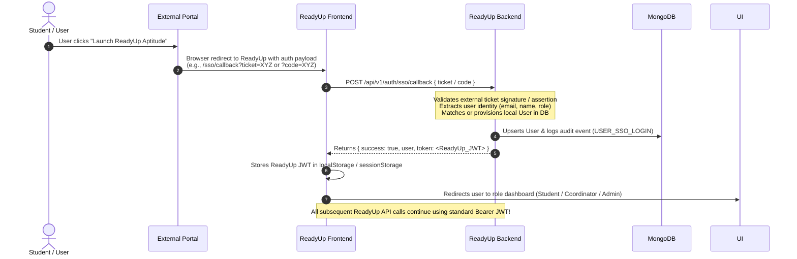

# ReadyUp — Complete API Contract & Frontend Integration Specification

> **Version:** 1.0.0  
> **Status:** Implemented & Verified on `Backend` branch  
> **Target Audience:** ReadyUp Frontend Development Team  
> **Base URL:** `http://localhost:5001/api/v1`  
> **Default Port:** `5001`  

---

## Table of Contents

1. [Visual Design System & Frontend UI Mapping](#1-visual-design-system--frontend-ui-mapping)
2. [Global Architecture & Conventions](#2-global-architecture--conventions)
   - [Standard Success Response](#standard-success-response)
   - [Standard Paginated Response](#standard-paginated-response)
   - [Standard Error Response](#standard-error-response)
   - [HTTP Status Codes](#http-status-codes)
3. [Implemented Endpoints vs. Planned Endpoints](#3-implemented-endpoints-vs-planned-endpoints)
4. [Complete Endpoint Reference (Implemented)](#4-complete-endpoint-reference-implemented)
   - [4.1 Health Check](#41-health-check)
   - [4.2 Authentication & User Profile](#42-authentication--user-profile)
   - [4.3 Aptitude Categories, Topics & Questions](#43-aptitude-categories-topics--questions)
   - [4.4 Companies & Hiring Patterns](#44-companies--hiring-patterns)
   - [4.5 Practice Drills & Mock Tests](#45-practice-drills--mock-tests)
   - [4.6 Question Bookmarks](#46-question-bookmarks)
   - [4.7 Student Analytics & Dashboards](#47-student-analytics--dashboards)
   - [4.8 T&P Coordinator Question Management & Spreadsheet Imports](#48-tp-coordinator-question-management--spreadsheet-imports)
   - [4.9 Admin User Management & Platform Audit Logs](#49-admin-user-management--platform-audit-logs)
5. [Frontend Form Specifications](#5-frontend-form-specifications)
6. [Excel/CSV Spreadsheet Import Workflow](#6-excelcsv-spreadsheet-import-workflow)
7. [External Website Redirect & SSO Architecture](#7-external-website-redirect--sso-architecture)
   - [Current Authentication Flow](#71-current-authentication-flow)
   - [Designed SSO Handoff Integration](#72-designed-sso-handoff-integration)
   - [Information Required Before Implementation](#73-information-required-before-implementation)
8. [Sample Credentials for Local Development](#8-sample-credentials-for-local-development)

---

## 1. Visual Design System & Frontend UI Mapping

The ReadyUp visual design system is based on the **ProjectSync / Mentor Workspace** reference UI:

| Token / Element | Value / Rule | Frontend Usage |
| :--- | :--- | :--- |
| **Primary Accent** | `#0D9488` (Teal 600) / `#0F766E` (Teal 700) | Primary CTA buttons, active sidebar items, header highlights |
| **Primary Hover** | `#115E59` (Teal 800) | Button hover & active states |
| **Soft Surface Tint** | `#F0FDF4` (Mint 50) / `#ECFDF5` | Selected card backgrounds, icon containers, active nav pills |
| **App Canvas Background** | `#F8FAFC` (Slate 50) | Main page body background |
| **Card Surface** | `#FFFFFF` (Pure White) | Card containers with `border: 1px solid #F1F5F9` |
| **Border Radii** | `16px` to `20px` for cards, `9999px` for pills/buttons | Rounded components matching screenshot |
| **Elevation / Shadow** | `0 1px 3px rgba(0,0,0,0.04), 0 1px 2px rgba(0,0,0,0.02)` | Subtle depth without harsh drop-shadows |
| **Badge: Pending / Needs Review** | Background: `#FEF3C7` (Amber 100), Text: `#B45309` (Amber 700) | Test attempts needing review, pending imports |
| **Badge: Passed / Verified** | Background: `#DCFCE7` (Emerald 100), Text: `#15803D` (Emerald 700) | Passed tests, verified questions |
| **Badge: Changes / Incomplete** | Background: `#FEE2E2` (Rose 100), Text: `#B91C1C` (Rose 700) | Deactivated status, failed attempts |

### Pre-Aggregated Dashboard Endpoints

To avoid client-side computation, the backend provides three role-tailored dashboard endpoints:
1. **Student Dashboard:** `GET /api/v1/analytics/dashboard`
   - Feeds the 4 metric cards (Tests Completed, Average Accuracy %, Study Time in hours, Pass Rate).
   - Feeds the prominent **"NEXT BEST ACTION"** banner card (e.g., lowest-accuracy topic recommendation with direct practice query).
   - Feeds the **Weekly Goal Donut** widget (`percentage: 50`, `current: 2`, `target: 4`).
   - Feeds Recent Test Attempts with pre-formatted status badges (`Passed` or `Needs Review`).
2. **Coordinator Dashboard:** `GET /api/v1/coordinator/dashboard`
   - Feeds question bank metric cards, pending import counts, and recent spreadsheet upload history.
3. **Admin Dashboard:** `GET /api/v1/admin/dashboard`
   - Feeds total user counts by role, active users, total test attempts conducted, platform pass rate, and recent audit logs.

---

## 2. Global Architecture & Conventions

### Authentication Header
Protected endpoints require an HTTP `Authorization` header containing the JWT token returned by the login endpoint:
```http
Authorization: Bearer <YOUR_JWT_TOKEN>
```

### Standard Success Response
Every successful API request returns HTTP `200` (or `201` for created resources) with this consistent envelope:
```json
{
  "success": true,
  "message": "Human-readable status or confirmation message",
  "data": { ... }
}
```

### Standard Paginated Response
Endpoints returning paginated lists include a `pagination` metadata object:
```json
{
  "success": true,
  "message": "Items retrieved successfully",
  "data": [ ... ],
  "pagination": {
    "total": 45,
    "page": 1,
    "limit": 20,
    "totalPages": 3,
    "hasNextPage": true,
    "hasPrevPage": false
  }
}
```

### Standard Error Response
If an error occurs, the server returns an appropriate HTTP error status (`400`, `401`, `403`, `404`, `409`, `500`) with:
```json
{
  "success": false,
  "message": "Descriptive error message"
}
```
If the error is due to form or parameter validation, a detailed `errors` array is included:
```json
{
  "success": false,
  "message": "Validation failed",
  "errors": [
    {
      "field": "email",
      "message": "Please enter a valid email address"
    },
    {
      "field": "password",
      "message": "Password must be at least 6 characters long"
    }
  ]
}
```

### HTTP Status Codes
- `200 OK`: Request succeeded.
- `201 Created`: Resource successfully created.
- `400 Bad Request`: Invalid payload, missing fields, or validation failure.
- `401 Unauthorized`: Missing, expired, or invalid authentication token.
- `403 Forbidden`: Authenticated user's role lacks permission for the endpoint.
- `404 Not Found`: Requested resource does not exist.
- `409 Conflict`: Duplicate unique key (e.g. email or `questionId` already registered).
- `500 Internal Server Error`: Server exception.

---

## 3. Implemented Endpoints vs. Planned Endpoints

### ✅ Fully Implemented and Verified Endpoints (Ready for Frontend)

| Module | Method | Endpoint | Required Role |
| :--- | :--- | :--- | :--- |
| **System** | `GET` | `/api/v1/health` | Public |
| **Auth** | `POST` | `/api/v1/auth/register` | Public |
| **Auth** | `POST` | `/api/v1/auth/login` | Public |
| **Auth** | `POST` | `/api/v1/auth/logout` | Authenticated (Any) |
| **Auth** | `GET` | `/api/v1/auth/me` | Authenticated (Any) |
| **Auth** | `PUT` | `/api/v1/auth/profile` | Authenticated (Any) |
| **Auth** | `PUT` | `/api/v1/auth/change-password` | Authenticated (Any) |
| **Questions** | `GET` | `/api/v1/questions/categories` | Authenticated (Any) |
| **Questions** | `GET` | `/api/v1/questions` | Authenticated (Any) |
| **Questions** | `GET` | `/api/v1/questions/:id` | Authenticated (Any) |
| **Questions** | `POST` | `/api/v1/questions` | **Coordinator Only** |
| **Questions** | `PUT` | `/api/v1/questions/:id` | **Coordinator Only** |
| **Questions** | `PATCH` | `/api/v1/questions/:id/status` | **Coordinator Only** |
| **Companies** | `GET` | `/api/v1/companies` | Authenticated (Any) |
| **Companies** | `GET` | `/api/v1/companies/:slug` | Authenticated (Any) |
| **Tests** | `GET` | `/api/v1/tests/mock-tests` | Authenticated (Any) |
| **Tests** | `GET` | `/api/v1/tests/mock-tests/:id` | Authenticated (Any) |
| **Tests** | `POST` | `/api/v1/tests/practice/start` | **Student Only** |
| **Tests** | `POST` | `/api/v1/tests/mock-tests/:id/start` | **Student Only** |
| **Tests** | `POST` | `/api/v1/tests/attempts/:attemptId/submit` | **Student Only** |
| **Tests** | `GET` | `/api/v1/tests/attempts/:attemptId/review` | **Student Only** |
| **Tests** | `GET` | `/api/v1/tests/history` | **Student Only** |
| **Tests** | `GET` | `/api/v1/tests/incorrect` | **Student Only** |
| **Tests** | `POST` | `/api/v1/tests/mock-tests` | **Coordinator Only** |
| **Bookmarks** | `GET` | `/api/v1/bookmarks` | **Student Only** |
| **Bookmarks** | `POST` | `/api/v1/bookmarks` | **Student Only** |
| **Bookmarks** | `DELETE` | `/api/v1/bookmarks/:questionId` | **Student Only** |
| **Analytics** | `GET` | `/api/v1/analytics/dashboard` | **Student Only** |
| **Coordinator** | `GET` | `/api/v1/coordinator/dashboard` | **Coordinator Only** |
| **Coordinator** | `GET` | `/api/v1/coordinator/import/template` | **Coordinator Only** |
| **Coordinator** | `POST` | `/api/v1/coordinator/import/preview` | **Coordinator Only** |
| **Coordinator** | `POST` | `/api/v1/coordinator/import/confirm` | **Coordinator Only** |
| **Coordinator** | `GET` | `/api/v1/coordinator/import/history` | **Coordinator Only** |
| **Admin** | `GET` | `/api/v1/admin/dashboard` | **Admin Only** |
| **Admin** | `GET` | `/api/v1/admin/users` | **Admin Only** |
| **Admin** | `POST` | `/api/v1/admin/users` | **Admin Only** |
| **Admin** | `GET` | `/api/v1/admin/users/:id` | **Admin Only** |
| **Admin** | `PATCH` | `/api/v1/admin/users/:id/role` | **Admin Only** |
| **Admin** | `PATCH` | `/api/v1/admin/users/:id/status` | **Admin Only** |
| **Admin** | `GET` | `/api/v1/admin/audit-logs` | **Admin Only** |

### ⏳ Planned Endpoints (Not Implemented / Pending Spec)

The following endpoints are **planned** for external SSO integration and will be activated once the external authentication protocol is determined:

| Planned Endpoint | Method | Intended Function | Status |
| :--- | :--- | :--- | :--- |
| `/api/v1/auth/sso/callback` | `POST` | Accept external SSO ticket/assertion and return ReadyUp JWT | Planned (spec below) |
| `/api/v1/auth/sso/config` | `GET` | Return public SSO redirect URL for external portal | Planned |

---

## 4. Complete Endpoint Reference (Implemented)

### 4.1 Health Check

#### `GET /api/v1/health`
- **Access:** Public
- **Description:** Verifies API service uptime and operational status.
- **Success Response (`200 OK`):**
  ```json
  {
    "status": "healthy",
    "timestamp": "2026-10-14T17:00:00.000Z",
    "service": "ReadyUp Aptitude Backend API",
    "version": "1.0.0"
  }
  ```

---

### 4.2 Authentication & User Profile

#### `POST /api/v1/auth/register`
- **Access:** Public
- **Description:** Register a new user account.
- **Request Headers:** `Content-Type: application/json`
- **Request Body:**
  ```json
  {
    "name": "Aarav Sharma",
    "email": "aarav@readyup.edu",
    "password": "Password123!",
    "role": "student",
    "department": "Computer Science & Engineering",
    "college": "National Institute of Technology",
    "graduationYear": 2026,
    "studentId": "CS2026-042"
  }
  ```
- **Validation Rules:**
  - `name`: string, min 2 chars, max 100 chars (Required)
  - `email`: valid email string (Required, unique)
  - `password`: string, min 6 chars (Required)
  - `role`: `'student'` \| `'coordinator'` \| `'admin'` (Optional, default: `'student'`)
  - `department`, `college`, `studentId`: string (Optional)
  - `graduationYear`: integer between 2000 and 2100 (Optional)
- **Success Response (`201 Created`):**
  ```json
  {
    "success": true,
    "message": "User registered successfully",
    "data": {
      "user": {
        "_id": "670cfa3410a8b92d6e3f4121",
        "name": "Aarav Sharma",
        "email": "aarav@readyup.edu",
        "role": "student",
        "department": "Computer Science & Engineering",
        "college": "National Institute of Technology",
        "graduationYear": 2026,
        "studentId": "CS2026-042",
        "isActive": true,
        "createdAt": "2026-10-14T17:00:00.000Z",
        "updatedAt": "2026-10-14T17:00:00.000Z"
      },
      "token": "eyJhbGciOiJIUzI1NiIsInR5cCI6IkpXVCJ9..."
    }
  }
  ```
- **Error Responses:**
  - `400 Bad Request`: Field validation error.
  - `409 Conflict`: `"An account with this email address already exists"`.

#### `POST /api/v1/auth/login`
- **Access:** Public
- **Description:** Sign in using email and password.
- **Request Body:**
  ```json
  {
    "email": "aarav@readyup.edu",
    "password": "Password123!"
  }
  ```
- **Success Response (`200 OK`):**
  ```json
  {
    "success": true,
    "message": "Logged in successfully",
    "data": {
      "user": {
        "_id": "670cfa3410a8b92d6e3f4121",
        "name": "Aarav Sharma",
        "email": "aarav@readyup.edu",
        "role": "student",
        "department": "Computer Science & Engineering",
        "college": "National Institute of Technology",
        "graduationYear": 2026,
        "studentId": "CS2026-042",
        "isActive": true,
        "lastLoginAt": "2026-10-14T17:05:00.000Z"
      },
      "token": "eyJhbGciOiJIUzI1NiIsInR5cCI6IkpXVCJ9..."
    }
  }
  ```
- **Error Responses:**
  - `401 Unauthorized`: `"Invalid email or password"`.
  - `403 Forbidden`: `"This account has been deactivated. Please contact an administrator."`.

#### `POST /api/v1/auth/logout`
- **Access:** Authenticated (Any role)
- **Description:** Invalidate client session.
- **Success Response (`200 OK`):**
  ```json
  {
    "success": true,
    "message": "Logged out successfully",
    "data": null
  }
  ```

#### `GET /api/v1/auth/me`
- **Access:** Authenticated (Any role)
- **Description:** Retrieve current authenticated user's profile.
- **Success Response (`200 OK`):** Returns user profile object.

#### `PUT /api/v1/auth/profile`
- **Access:** Authenticated (Any role)
- **Description:** Update current user's personal details. Note: `role`, `email`, and `password` cannot be modified through this endpoint.
- **Request Body:**
  ```json
  {
    "name": "Aarav K. Sharma",
    "department": "Information Technology",
    "college": "National Institute of Technology",
    "graduationYear": 2026,
    "studentId": "IT2026-088"
  }
  ```
- **Success Response (`200 OK`):** Returns updated user profile.

#### `PUT /api/v1/auth/change-password`
- **Access:** Authenticated (Any role)
- **Request Body:**
  ```json
  {
    "currentPassword": "Password123!",
    "newPassword": "NewStrongPassword456!"
  }
  ```
- **Success Response (`200 OK`):**
  ```json
  {
    "success": true,
    "message": "Password changed successfully",
    "data": null
  }
  ```
- **Error Responses:**
  - `400 Bad Request`: `"Current password does not match"` or new password too short.

---

### 4.3 Aptitude Categories, Topics & Questions

#### `GET /api/v1/questions/categories`
- **Access:** Authenticated (Any role)
- **Description:** Get all categories (Quantitative Aptitude, Logical Reasoning, Verbal Ability, Data Interpretation) along with their nested topics, subtopics, and active question counts.
- **Success Response (`200 OK`):**
  ```json
  {
    "success": true,
    "message": "Categories and topics retrieved successfully",
    "data": [
      {
        "_id": "670cfa3410a8b92d6e3f4130",
        "name": "Quantitative Aptitude",
        "slug": "quantitative-aptitude",
        "description": "Mathematical, arithmetic, and numerical reasoning topics",
        "icon": "Calculator",
        "topics": [
          {
            "_id": "670cfa3410a8b92d6e3f4135",
            "name": "Time and Work",
            "slug": "time-and-work",
            "subtopics": ["Combined Work", "Pipes and Cisterns"],
            "questionCount": 42
          }
        ]
      }
    ]
  }
  ```

#### `GET /api/v1/questions`
- **Access:** Authenticated (Any role)
- **Description:** Browse and filter questions.
- **Query Parameters:**
  - `category` (string, optional)
  - `topic` (string, optional)
  - `subtopic` (string, optional)
  - `difficulty` (string: `'easy'` \| `'medium'` \| `'hard'`, optional)
  - `company` (string: e.g. `'TCS'`, optional)
  - `search` (string: searches question text, ID, or topic, optional)
  - `page` (integer, default: `1`)
  - `limit` (integer, default: `20`)
- **Success Response (`200 OK`):** Returns standard paginated response containing array of question items.

#### `GET /api/v1/questions/:id`
- **Access:** Authenticated (Any role)
- **Param:** `:id` (Can be MongoDB ObjectId or stable `questionId` like `QA-TW-001`)
- **Success Response (`200 OK`):**
  ```json
  {
    "success": true,
    "message": "Question details retrieved successfully",
    "data": {
      "_id": "670cfa3410a8b92d6e3f4150",
      "questionId": "QA-TW-001",
      "questionText": "A can complete a piece of work in 12 days, while B can complete it in 18 days...",
      "options": [
        { "optionId": "A", "text": "7.2 days" },
        { "optionId": "B", "text": "6.5 days" },
        { "optionId": "C", "text": "8.0 days" },
        { "optionId": "D", "text": "5.4 days" }
      ],
      "correctOption": "A",
      "explanation": "A's 1-day work = 1/12. B's 1-day work = 1/18...",
      "category": "Quantitative Aptitude",
      "topic": "Time and Work",
      "subtopic": "Combined Work",
      "difficulty": "easy",
      "companies": ["TCS", "Infosys"],
      "source": "TCS NQT 2024",
      "year": 2024,
      "isVerified": true,
      "isActive": true
    }
  }
  ```

#### `POST /api/v1/questions`
- **Access:** **Coordinator Only**
- **Description:** Add a single question directly.
- **Request Body:**
  ```json
  {
    "questionId": "QA-TW-105",
    "questionText": "A can finish a work in 15 days and B in 20 days...",
    "options": [
      { "optionId": "A", "text": "8.57 days" },
      { "optionId": "B", "text": "9.20 days" },
      { "optionId": "C", "text": "7.50 days" },
      { "optionId": "D", "text": "10.0 days" }
    ],
    "correctOption": "A",
    "explanation": "1/15 + 1/20 = 7/60 => 60/7 = 8.57 days.",
    "category": "Quantitative Aptitude",
    "topic": "Time and Work",
    "subtopic": "Combined Work",
    "difficulty": "easy",
    "companies": ["TCS"],
    "source": "Campus Placement 2025",
    "year": 2025,
    "isActive": true
  }
  ```
- **Success Response (`201 Created`):** Returns created question object.

#### `PUT /api/v1/questions/:id`
- **Access:** **Coordinator Only**
- **Description:** Update question content. (`questionId` cannot be changed).

#### `PATCH /api/v1/questions/:id/status`
- **Access:** **Coordinator Only**
- **Request Body:** `{ "isActive": false }`
- **Success Response (`200 OK`):** Returns updated question object.

---

### 4.4 Companies & Hiring Patterns

#### `GET /api/v1/companies`
- **Access:** Authenticated (Any role)
- **Description:** List top placement hiring companies, test patterns, eligibility criteria, and active question counts.
- **Success Response (`200 OK`):**
  ```json
  {
    "success": true,
    "message": "Companies retrieved successfully",
    "data": [
      {
        "_id": "670cfa3410a8b92d6e3f4160",
        "name": "TCS",
        "slug": "tcs",
        "description": "Tata Consultancy Services - National Qualifier Test (NQT)",
        "hiringPattern": "Numerical Ability (26 Qs), Reasoning Ability (30 Qs), Verbal Ability (24 Qs).",
        "eligibilityNotes": "60% or 6.0 CGPA throughout 10th, 12th, and UG.",
        "questionCount": 140,
        "isActive": true
      }
    ]
  }
  ```

#### `GET /api/v1/companies/:slug`
- **Access:** Authenticated (Any role)
- **Description:** Get company details with category and topic question counts.

---

### 4.5 Practice Drills & Mock Tests

#### `GET /api/v1/tests/mock-tests`
- **Access:** Authenticated (Any role)
- **Query Params:** `company`, `type` (`company_mock` \| `topic_test` \| `diagnostic`), `page`, `limit`
- **Success Response (`200 OK`):** Paginated list of mock tests (questions omitted until test started).

#### `GET /api/v1/tests/mock-tests/:id`
- **Access:** Authenticated (Any role)
- **Description:** Retrieve mock test metadata, instructions, and duration before starting.

#### `POST /api/v1/tests/practice/start`
- **Access:** **Student Only**
- **Description:** Start a flexible practice session. **Note:** Correct options and explanations are intentionally stripped from this payload to ensure honest practice.
- **Request Body:**
  ```json
  {
    "category": "Quantitative Aptitude",
    "topic": "Time and Work",
    "difficulty": "medium",
    "company": "TCS",
    "count": 10
  }
  ```
- **Success Response (`201 Created`):**
  ```json
  {
    "success": true,
    "message": "Practice session initialized successfully",
    "data": {
      "attemptId": "670cfa3410a8b92d6e3f4180",
      "title": "Practice: Time and Work (medium)",
      "type": "practice",
      "totalQuestions": 10,
      "startedAt": "2026-10-14T17:10:00.000Z",
      "questions": [
        {
          "_id": "670cfa3410a8b92d6e3f4150",
          "questionId": "QA-TW-001",
          "questionText": "A can complete a piece of work in 12 days...",
          "options": [
            { "optionId": "A", "text": "7.2 days" },
            { "optionId": "B", "text": "6.5 days" },
            { "optionId": "C", "text": "8.0 days" },
            { "optionId": "D", "text": "5.4 days" }
          ],
          "category": "Quantitative Aptitude",
          "topic": "Time and Work",
          "difficulty": "medium"
        }
      ]
    }
  }
  ```

#### `POST /api/v1/tests/mock-tests/:id/start`
- **Access:** **Student Only**
- **Description:** Start a timed mock test. Server calculates `expiresAt` deadline based on test duration.
- **Success Response (`201 Created`):**
  ```json
  {
    "success": true,
    "message": "Mock test started. Timer is now running.",
    "data": {
      "attemptId": "670cfa3410a8b92d6e3f4190",
      "mockTestId": "670cfa3410a8b92d6e3f4175",
      "title": "TCS NQT National Mock 1",
      "company": "TCS",
      "durationMinutes": 45,
      "totalMarks": 10,
      "passingMarks": 6,
      "instructions": ["Each question carries 1 mark...", "Do not refresh..."],
      "startedAt": "2026-10-14T17:15:00.000Z",
      "expiresAt": "2026-10-14T18:00:00.000Z",
      "questions": [ ... ]
    }
  }
  ```

#### `POST /api/v1/tests/attempts/:attemptId/submit`
- **Access:** **Student Only**
- **Description:** Submit answers for scoring. Evaluated server-side against ground-truth keys. Calculates accuracy, topic breakdown, and recommendations.
- **Request Body:**
  ```json
  {
    "answers": [
      {
        "questionId": "QA-TW-001",
        "selectedOption": "A",
        "timeSpentSeconds": 45,
        "markedForReview": false
      },
      {
        "questionId": "QA-TW-002",
        "selectedOption": "D",
        "timeSpentSeconds": 60,
        "markedForReview": false
      }
    ]
  }
  ```
- **Success Response (`200 OK`):**
  ```json
  {
    "success": true,
    "message": "Test submitted and scored successfully",
    "data": {
      "attemptId": "670cfa3410a8b92d6e3f4190",
      "title": "TCS NQT National Mock 1",
      "type": "mock_test",
      "company": "TCS",
      "status": "completed",
      "submittedAt": "2026-10-14T17:35:00.000Z",
      "durationSeconds": 1200,
      "totalQuestions": 10,
      "attemptedCount": 10,
      "correctCount": 8,
      "incorrectCount": 2,
      "unansweredCount": 0,
      "score": 8,
      "totalMarks": 10,
      "percentage": 80.0,
      "passed": true,
      "topicBreakdown": [
        {
          "topic": "Time and Work",
          "category": "Quantitative Aptitude",
          "total": 5,
          "attempted": 5,
          "correct": 4,
          "incorrect": 1,
          "unanswered": 0,
          "accuracy": 80.0
        }
      ],
      "recommendations": [
        {
          "topic": "Time and Work",
          "category": "Quantitative Aptitude",
          "accuracy": 80.0,
          "status": "strong",
          "message": "Strong mastery in Time and Work (80% accuracy). Maintain consistency with timed drills."
        }
      ]
    }
  }
  ```

#### `GET /api/v1/tests/attempts/:attemptId/review`
- **Access:** **Student Only** (Student can only review their own attempts)
- **Description:** View full review with questions, student answers, correct options, and step-by-step explanations.

#### `GET /api/v1/tests/history`
- **Access:** **Student Only**
- **Query Params:** `page`, `limit`, `type` (`mock_test` \| `practice`)
- **Success Response (`200 OK`):** Paginated history of student's completed tests.

#### `GET /api/v1/tests/incorrect`
- **Access:** **Student Only**
- **Query Params:** `limit` (default: 20)
- **Description:** Returns unique questions the student missed in past attempts for targeted drill practice.

#### `POST /api/v1/tests/mock-tests`
- **Access:** **Coordinator Only**
- **Description:** Create a new standardized mock test template.

---

### 4.6 Question Bookmarks

#### `GET /api/v1/bookmarks`
- **Access:** **Student Only**
- **Query Params:** `page`, `limit`
- **Success Response (`200 OK`):** Returns student's bookmarked questions with populated question objects and personal notes.

#### `POST /api/v1/bookmarks`
- **Access:** **Student Only**
- **Request Body:**
  ```json
  {
    "questionId": "QA-TW-001",
    "note": "Revise 1-day work formula before TCS exam"
  }
  ```
- **Success Response (`201 Created`):** Returns bookmark object.

#### `DELETE /api/v1/bookmarks/:questionId`
- **Access:** **Student Only**
- **Param:** `:questionId` (Can be questionId string or question ObjectId)
- **Success Response (`200 OK`):** `{ "success": true, "message": "Bookmark removed successfully", "data": null }`

---

### 4.7 Student Analytics & Dashboards

#### `GET /api/v1/analytics/dashboard`
- **Access:** **Student Only**
- **Description:** Returns pre-aggregated performance data matching the reference dashboard UI:
  - 4 Metric cards
  - "NEXT BEST ACTION" banner recommendation
  - Weekly progress circular widget
  - Category masteries
  - Top 5 weaker topics (<60% accuracy) & top 5 strong topics (>=75% accuracy)
  - Recent test history with status badges
- **Success Response (`200 OK`):**
  ```json
  {
    "success": true,
    "message": "Student dashboard metrics retrieved successfully",
    "data": {
      "student": {
        "name": "Aarav Sharma",
        "email": "student@readyup.edu",
        "department": "Computer Science & Engineering",
        "graduationYear": 2026
      },
      "metrics": [
        {
          "id": "tests_attempted",
          "label": "Tests Completed",
          "value": 14,
          "subtext": "3 this week",
          "icon": "FileCheck"
        },
        {
          "id": "avg_accuracy",
          "label": "Average Accuracy",
          "value": "74.5%",
          "subtext": "Across all topics",
          "icon": "Target"
        },
        {
          "id": "practice_time",
          "label": "Study Time",
          "value": "8.2 hrs",
          "subtext": "Active practice time",
          "icon": "Clock"
        },
        {
          "id": "pass_rate",
          "label": "Pass Rate",
          "value": "85.7%",
          "subtext": "12 of 14 passed",
          "icon": "Award"
        }
      ],
      "nextBestAction": {
        "label": "RECOMMENDED PRACTICE",
        "title": "Practice Time and Work",
        "description": "Your accuracy in Time and Work is 50%. Solve a curated 10-question practice set to build speed and accuracy.",
        "ctaText": "Start Practice →",
        "actionType": "PRACTICE",
        "targetTopic": "Time and Work",
        "targetCategory": "Quantitative Aptitude"
      },
      "weeklyProgress": {
        "percentage": 75,
        "current": 3,
        "target": 4,
        "label": "Weekly Mock Test Goal"
      },
      "categoryBreakdown": [
        { "category": "Quantitative Aptitude", "accuracy": 72, "totalAttempted": 60 },
        { "category": "Logical Reasoning", "accuracy": 80, "totalAttempted": 45 },
        { "category": "Verbal Ability", "accuracy": 78, "totalAttempted": 35 }
      ],
      "weakTopics": [
        { "topic": "Time and Work", "category": "Quantitative Aptitude", "totalQuestions": 10, "accuracy": 50 }
      ],
      "strongTopics": [
        { "topic": "Percentages", "category": "Quantitative Aptitude", "totalQuestions": 12, "accuracy": 83 }
      ],
      "recentAttempts": [
        {
          "id": "670cfa3410a8b92d6e3f4190",
          "title": "TCS NQT National Mock 1",
          "type": "mock_test",
          "submittedAt": "2026-10-14T15:30:00.000Z",
          "score": 8,
          "totalMarks": 10,
          "percentage": 80.0,
          "passed": true,
          "statusBadge": "Passed"
        }
      ],
      "bookmarkCount": 5
    }
  }
  ```

---

### 4.8 T&P Coordinator Question Management & Spreadsheet Imports

#### `GET /api/v1/coordinator/dashboard`
- **Access:** **Coordinator Only**
- **Description:** Returns question bank statistics, active topic counts, pending import reviews, and recent upload activity.

#### `GET /api/v1/coordinator/import/template`
- **Access:** **Coordinator Only**
- **Query Params:** `format` (`csv` \| `xlsx`, default: `xlsx`)
- **Response:** File attachment download (`readyup_questions_template.csv` or `.xlsx`) with headers and styled sample rows.

#### `POST /api/v1/coordinator/import/preview`
- **Access:** **Coordinator Only**
- **Description:** Uploads spreadsheet for row-by-row validation. Valid rows are staged in `ImportHistory` with status `'previewed'`. **No questions are published to the live question bank until confirmed.**
- **Request Headers:** `Content-Type: multipart/form-data`
- **Form Field:** `file` (Binary file, `.xlsx` or `.csv`, max 10MB)
- **Success Response (`200 OK`):**
  ```json
  {
    "success": true,
    "message": "Spreadsheet parsed successfully. 25 valid rows ready for review, 2 invalid rows flagged.",
    "data": {
      "importBatchId": "batch_1760441500000_a8bc12",
      "totalRows": 27,
      "validRowsCount": 25,
      "invalidRowsCount": 2,
      "errors": [
        {
          "rowNumber": 4,
          "questionId": "QA-TW-004",
          "field": "correctOption",
          "error": "Correct option must be one of A, B, C, or D"
        },
        {
          "rowNumber": 12,
          "questionId": "Row 12",
          "field": "questionText",
          "error": "Question text must be at least 5 characters long"
        }
      ],
      "previewSample": [
        {
          "rowNumber": 2,
          "questionId": "QA-TW-001",
          "questionText": "A can complete a piece of work in 12 days...",
          "topic": "Time and Work",
          "difficulty": "easy"
        }
      ]
    }
  }
  ```

#### `POST /api/v1/coordinator/import/confirm`
- **Access:** **Coordinator Only**
- **Description:** Confirms and commits staged rows into the database. Idempotent upsert by `questionId` (existing questions are updated, new questions are inserted, no questions are deleted). Topics and companies are automatically synchronized.
- **Request Body:**
  ```json
  {
    "importBatchId": "batch_1760441500000_a8bc12"
  }
  ```
- **Success Response (`200 OK`):**
  ```json
  {
    "success": true,
    "message": "Import confirmed and published successfully into question bank",
    "data": {
      "importBatchId": "batch_1760441500000_a8bc12",
      "filename": "tcs_2026_questions.csv",
      "status": "published",
      "insertedCount": 20,
      "updatedCount": 5,
      "skippedCount": 0,
      "totalProcessed": 25
    }
  }
  ```

#### `GET /api/v1/coordinator/import/history`
- **Access:** **Coordinator Only**
- **Query Params:** `page`, `limit`
- **Success Response (`200 OK`):** Paginated list of past spreadsheet imports, total rows, uploader, timestamp, and publish status.

---

### 4.9 Admin User Management & Platform Audit Logs

#### `GET /api/v1/admin/dashboard`
- **Access:** **Admin Only**
- **Description:** Platform summary: registered student count, coordinator count, total questions bank, test attempts count, platform pass rate, and recent audit logs.

#### `GET /api/v1/admin/users`
- **Access:** **Admin Only**
- **Query Params:** `role` (`student` \| `coordinator` \| `admin`), `isActive` (`true` \| `false`), `search` (name, email, department), `page`, `limit`
- **Success Response (`200 OK`):** Paginated list of users.

#### `POST /api/v1/admin/users`
- **Access:** **Admin Only**
- **Description:** Directly provision a new user account.
- **Request Body:**
  ```json
  {
    "name": "Prof. Sunita Patil",
    "email": "sunita.patil@readyup.edu",
    "password": "InitialSecurePassword123!",
    "role": "coordinator",
    "department": "Training & Placement Cell",
    "college": "National Institute of Technology",
    "studentId": "EMP-TP-04"
  }
  ```

#### `GET /api/v1/admin/users/:id`
- **Access:** **Admin Only**
- **Description:** Retrieve single user account details.

#### `PATCH /api/v1/admin/users/:id/role`
- **Access:** **Admin Only**
- **Description:** Assign role to user account. Note: Admins cannot demote their own account.
- **Request Body:** `{ "role": "coordinator" }`

#### `PATCH /api/v1/admin/users/:id/status`
- **Access:** **Admin Only**
- **Description:** Activate or deactivate user. Note: Admins cannot deactivate their own account.
- **Request Body:** `{ "isActive": false }`

#### `GET /api/v1/admin/audit-logs`
- **Access:** **Admin Only**
- **Query Params:** `action`, `targetType`, `role`, `page`, `limit`
- **Description:** Searchable audit trail of administrative operations (role assignments, user creations, question imports, logins).

---

## 5. Frontend Form Specifications

The frontend branch should implement the following forms matching these exact field names and types:

### Form 1: Student / User Registration Form
- **Page:** `/register`
- **Endpoint:** `POST /api/v1/auth/register`
- **Content-Type:** `application/json`

| Field Name | Label | Input Type | Required | Validation Rules | Error Message |
| :--- | :--- | :--- | :---: | :--- | :--- |
| `name` | Full Name | `text` | Yes | 2–100 characters | Name must be at least 2 characters long |
| `email` | Institutional Email | `email` | Yes | Valid email format | Please enter a valid email address |
| `password` | Password | `password` | Yes | Minimum 6 characters | Password must be at least 6 characters long |
| `role` | Account Role | `select` | No | Default: `'student'` | Role must be student, coordinator, or admin |
| `department`| Department | `text` | No | Optional (e.g. CSE) | — |
| `college` | College / Institute | `text` | No | Optional | — |
| `graduationYear`| Graduation Year| `number` | No | Integer 2000–2100 | Please enter a valid 4-digit graduation year |
| `studentId`| Roll No / Student ID| `text` | No | Optional | — |

---

### Form 2: User Login Form
- **Page:** `/login`
- **Endpoint:** `POST /api/v1/auth/login`
- **Content-Type:** `application/json`

| Field Name | Label | Input Type | Required | Validation Rules | Error Message |
| :--- | :--- | :--- | :---: | :--- | :--- |
| `email` | Email Address | `email` | Yes | Valid email | Please enter a valid email address |
| `password` | Password | `password` | Yes | Non-empty | Password is required |

---

### Form 3: Student Profile Update Form
- **Page:** `/profile`
- **Endpoint:** `PUT /api/v1/auth/profile`
- **Content-Type:** `application/json`

| Field Name | Label | Input Type | Required | Validation Rules | Error Message |
| :--- | :--- | :--- | :---: | :--- | :--- |
| `name` | Full Name | `text` | No | 2–100 characters | Name must be at least 2 characters |
| `department`| Department | `text` | No | Optional | — |
| `college` | College | `text` | No | Optional | — |
| `graduationYear`| Graduation Year| `number` | No | Integer 2000–2100 | Invalid graduation year |
| `studentId`| Roll No / ID | `text` | No | Optional | — |

---

### Form 4: Change Password Form
- **Page:** `/profile/security`
- **Endpoint:** `PUT /api/v1/auth/change-password`
- **Content-Type:** `application/json`

| Field Name | Label | Input Type | Required | Validation Rules | Error Message |
| :--- | :--- | :--- | :---: | :--- | :--- |
| `currentPassword`| Current Password | `password` | Yes | Non-empty | Current password is required |
| `newPassword` | New Password | `password` | Yes | Minimum 6 characters | New password must be at least 6 characters |

---

### Form 5: Start Practice Drill Form
- **Page:** `/practice`
- **Endpoint:** `POST /api/v1/tests/practice/start`
- **Content-Type:** `application/json`

| Field Name | Label | Input Type | Required | Validation Rules | Default |
| :--- | :--- | :--- | :---: | :--- | :--- |
| `category` | Category | `select` | No | Category name | All categories |
| `topic` | Topic | `select` | No | Topic name | All topics |
| `difficulty`| Difficulty Level | `select` | No | `'easy'` \| `'medium'` \| `'hard'` | All levels |
| `company` | Target Company | `select` | No | Company name (e.g. TCS) | All companies |
| `count` | Question Count | `number` | No | Integer between 3 and 50 | `10` |

---

### Form 6: Test Attempt Answer Submission
- **Page:** `/tests/take/:attemptId`
- **Endpoint:** `POST /api/v1/tests/attempts/:attemptId/submit`
- **Content-Type:** `application/json`

| Field Name | Type | Required | Validation Rules | Description |
| :--- | :--- | :---: | :--- | :--- |
| `answers` | `Array<AnswerItem>` | Yes | Non-empty array | Array of student answers |
| `answers[].questionId` | `string` | Yes | Matches questionId | Unique identifier |
| `answers[].selectedOption` | `'A' \| 'B' \| 'C' \| 'D' \| null` | Yes | Null if unattempted | Chosen option |
| `answers[].timeSpentSeconds` | `number` | No | `>= 0` | Time spent on question |
| `answers[].markedForReview` | `boolean` | No | `true` \| `false` | Review status flag |

---

### Form 7: Question Bookmark Form
- **Page:** `/practice` or `/tests/review/:attemptId`
- **Endpoint:** `POST /api/v1/bookmarks`
- **Content-Type:** `application/json`

| Field Name | Label | Input Type | Required | Description |
| :--- | :--- | :--- | :---: | :--- |
| `questionId` | Question ID | `hidden` | Yes | Stable question ID (e.g. `QA-TW-001`) |
| `note` | Personal Revision Note | `text` | No | Optional memo for future review |

---

### Form 8: Coordinator Single Question Creation Form
- **Page:** `/coordinator/questions/new`
- **Endpoint:** `POST /api/v1/questions`
- **Content-Type:** `application/json`

| Field Name | Label | Input Type | Required | Validation Rules |
| :--- | :--- | :--- | :---: | :--- |
| `questionId` | Unique Question ID | `text` | Yes | e.g. `QA-TW-101` (Uppercase, unique) |
| `questionText` | Question Text | `textarea` | Yes | Minimum 5 characters |
| `options[0].text` | Option A | `text` | Yes | Option A text (optionId: 'A') |
| `options[1].text` | Option B | `text` | Yes | Option B text (optionId: 'B') |
| `options[2].text` | Option C | `text` | Yes | Option C text (optionId: 'C') |
| `options[3].text` | Option D | `text` | Yes | Option D text (optionId: 'D') |
| `correctOption`| Correct Option | `select` | Yes | Must be `'A'`, `'B'`, `'C'`, or `'D'` |
| `explanation` | Step-by-Step Solution | `textarea` | Yes | Minimum 5 characters |
| `category` | Category | `select` | Yes | e.g. `'Quantitative Aptitude'` |
| `topic` | Topic | `select` | Yes | e.g. `'Time and Work'` |
| `subtopic` | Subtopic | `text` | No | e.g. `'Pipes and Cisterns'` |
| `difficulty` | Difficulty | `select` | Yes | `'easy'` \| `'medium'` \| `'hard'` |
| `companies` | Associated Companies | `text` / `tags`| No | Comma-separated or array of strings |
| `source` | Exam / Drive Source | `text` | No | e.g. `'TCS NQT 2025'` |
| `year` | Year | `number` | No | 1990–2100 |

---

### Form 9: Coordinator Excel/CSV File Upload Form
- **Page:** `/coordinator/import`
- **Endpoint:** `POST /api/v1/coordinator/import/preview`
- **Content-Type:** `multipart/form-data`

| Field Name | Label | Input Type | Required | Validation Rules | Error Message |
| :--- | :--- | :--- | :---: | :--- | :--- |
| `file` | Choose File | `file` | Yes | `.xlsx`, `.xls`, `.csv` (Max: 10MB) | File size exceeds 10MB or invalid format |

---

### Form 10: Coordinator Import Confirmation Form
- **Page:** `/coordinator/import/review`
- **Endpoint:** `POST /api/v1/coordinator/import/confirm`
- **Content-Type:** `application/json`

| Field Name | Label | Input Type | Required | Description |
| :--- | :--- | :--- | :---: | :--- |
| `importBatchId` | Staged Batch ID | `hidden` | Yes | Returned by `import/preview` endpoint |

---

### Form 11: Admin User Provisioning Form
- **Page:** `/admin/users/new`
- **Endpoint:** `POST /api/v1/admin/users`
- **Content-Type:** `application/json`

| Field Name | Label | Input Type | Required | Validation Rules |
| :--- | :--- | :--- | :---: | :--- |
| `name` | Full Name | `text` | Yes | Min 2 characters |
| `email` | Institutional Email | `email` | Yes | Valid email format, unique |
| `password` | Initial Password | `password` | Yes | Min 6 characters |
| `role` | Role | `select` | Yes | `'student'` \| `'coordinator'` \| `'admin'` |
| `department`| Department | `text` | No | Optional |
| `college` | College | `text` | No | Optional |
| `studentId`| Roll No / Employee ID| `text` | No | Optional |

---

### Form 12: Admin Role Assignment Form
- **Page:** `/admin/users/:id`
- **Endpoint:** `PATCH /api/v1/admin/users/:id/role`
- **Content-Type:** `application/json`

| Field Name | Label | Input Type | Required | Allowed Values |
| :--- | :--- | :--- | :---: | :--- |
| `role` | Assigned Role | `select` | Yes | `'student'` \| `'coordinator'` \| `'admin'` |

---

### Form 13: Admin Account Status Toggle Form
- **Page:** `/admin/users/:id`
- **Endpoint:** `PATCH /api/v1/admin/users/:id/status`
- **Content-Type:** `application/json`

| Field Name | Label | Input Type | Required | Description |
| :--- | :--- | :--- | :---: | :--- |
| `isActive` | Active Account Status | `toggle` / `checkbox` | Yes | `true` (Active) or `false` (Deactivated) |

---

## 6. Excel/CSV Spreadsheet Import Workflow

The spreadsheet upload feature allows the **T&P Coordinator** to bulk-manage the aptitude question repository without needing a software deployment or developer intervention.

```mermaid
sequenceDiagram
    autonumber
    actor C as T&P Coordinator
    participant UI as Frontend App
    participant API as ReadyUp Backend
    participant DB as MongoDB

    C->>UI: Selects .xlsx or .csv spreadsheet file
    UI->>API: POST /api/v1/coordinator/import/preview (multipart/form-data)
    Note over API: Parses spreadsheet rows<br/>Validates against Zod schema<br/>Flags invalid rows with line numbers
    API->>DB: Stores staged rows in ImportHistory (status: 'previewed')
    API-->>UI: Returns { importBatchId, validCount, invalidCount, errors, previewSample }
    UI-->>C: Displays Preview Modal with valid rows & error report
    C->>UI: Clicks "Confirm & Publish Questions"
    UI->>API: POST /api/v1/coordinator/import/confirm { importBatchId }
    Note over API: Idempotent Upsert by questionId<br/>Auto-syncs Topics & Companies
    API->>DB: Updates/Inserts Questions & Marks Batch 'published'
    API-->>UI: Returns { insertedCount, updatedCount, skippedCount }
    UI-->>C: Shows success toast; questions are immediately live!
```

### Spreadsheet Column Specification

| # | Column Header | Required | Example | Validation & Type Rules |
| :-: | :--- | :---: | :--- | :--- |
| 1 | `questionId` | **Yes** | `QA-TW-001` | Unique stable alphanumeric code. Used for upserts. |
| 2 | `questionText` | **Yes** | `A can do a work in 12 days...` | Minimum 5 characters long. |
| 3 | `optionA` | **Yes** | `7.2 days` | Non-empty string. |
| 4 | `optionB` | **Yes** | `6.5 days` | Non-empty string. |
| 5 | `optionC` | **Yes** | `8.0 days` | Non-empty string. |
| 6 | `optionD` | **Yes** | `5.4 days` | Non-empty string. |
| 7 | `correctOption`| **Yes** | `A` | Must be exactly `A`, `B`, `C`, or `D`. |
| 8 | `explanation`  | **Yes** | `A's 1-day work = 1/12...` | Step-by-step solution, minimum 5 characters. |
| 9 | `category`     | **Yes** | `Quantitative Aptitude` | e.g. Quantitative Aptitude, Logical Reasoning, Verbal Ability. |
| 10| `topic`        | **Yes** | `Time and Work` | Topic name. |
| 11| `subtopic`     | No | `Combined Work` | Optional subtopic. |
| 12| `difficulty`   | **Yes** | `easy` | Must be `easy`, `medium`, or `hard` (case-insensitive). |
| 13| `companies`    | No | `TCS, Infosys` | Comma-separated company names. |
| 14| `source`       | No | `TCS NQT 2024` | Placement season or exam identifier. |
| 15| `year`         | No | `2024` | 4-digit year. |

---

## 7. External Website Redirect & SSO Architecture

### 7.1 Current Authentication Flow

Currently, ReadyUp employs an internal, token-based authentication mechanism:
1. **User Credentials Check:** The user submits their email and password to `POST /api/v1/auth/login`.
2. **Password Verification:** The backend retrieves the user from MongoDB (including the hashed password via `+password`) and validates it using `bcrypt.compare()`.
3. **JWT Issuance:** Upon verification, `authService.generateToken(user)` generates a signed JSON Web Token (JWT) containing the user payload:
   ```json
   {
     "id": "670cfa3410a8b92d6e3f4121",
     "email": "student@readyup.edu",
     "role": "student",
     "name": "Aarav Sharma",
     "iat": 1760441500,
     "exp": 1761046300
   }
   ```
4. **Subsequent API Requests:** The frontend stores this token and passes it in the `Authorization: Bearer <token>` header for all authenticated API calls.
5. **Role-Based Guarding:** The `authenticate` middleware decodes and verifies the token, ensures `user.isActive === true`, and the `authorize('student' | 'coordinator' | 'admin')` middleware enforces strict role access.

---

### 7.2 Designed SSO Handoff Integration

To allow users to be redirected seamlessly from an external website (such as an institutional ERP, college LMS, or placement portal) without seeing a ReadyUp login page:



#### Key Architecture Principles for the SSO Integration:
1. **Separation of Concerns:** The SSO exchange endpoint (`POST /api/v1/auth/sso/callback`) is completely separated from the existing `/api/v1/auth/login` and `/api/v1/auth/register` endpoints. Standalone login remains available for development, testing, and system fallback.
2. **Internal Session Standardization:** Regardless of how the external site authenticates the user, once the handoff is validated, the ReadyUp backend issues a standard ReadyUp JWT. This ensures **zero changes** are required across existing controllers, middleware, or role authorization rules.
3. **Role Integrity:** The backend ensures that only authorized roles (`student`, `coordinator`, `admin`) can access corresponding endpoints.

---

### 7.3 Information Required Before Implementation

Because the external website's authentication protocol has not yet been specified, the following questions must be resolved before the SSO exchange endpoint can be finalized:

| Question # | Topic | Details Needed from External Website Team |
| :---: | :--- | :--- |
| **Q1** | **SSO Protocol** | Which standard protocol does the external website support? <br>• **OpenID Connect (OIDC) / OAuth 2.0** (Authorization Code flow)<br>• **SAML 2.0** (HTTP-POST / Artifact binding)<br>• **Signed Handoff Token** (JWT or ticket signed with a shared HMAC-SHA256 secret or RSA private key)<br>• **Direct Token Exchange API** (ReadyUp backend calls external `https://portal.edu/api/verify-ticket`) |
| **Q2** | **Identity Claims** | What exact claim/field names are provided in the external payload? <br>• User Email (e.g. `email` vs `mail` vs `sub`)<br>• Full Name (e.g. `name` vs `given_name` + `family_name`)<br>• Student / Employee ID (e.g. `studentId`, `rollNumber`, `empId`)<br>• Academic Department (e.g. `department`, `dept`) |
| **Q3** | **Role Derivation** | How should ReadyUp determine whether the incoming user is a `student`, `coordinator`, or `admin`? <br>• Option A: Explicit role claim in the external token (e.g., `role: "coordinator"`)<br>• Option B: External group membership list (e.g., `groups: ["TP_Cell", "Students"]`)<br>• Option C: Default all incoming SSO users to `student` role unless manually elevated by an Admin |
| **Q4** | **User Provisioning (JIT)** | Should ReadyUp automatically create new user accounts in MongoDB when a user visits via SSO for the first time (Just-In-Time provisioning)? |
| **Q5** | **Redirect Handoff URL** | What exact redirect URI will the external portal use? <br>• e.g. `https://readyup.edu/sso/callback?ticket=...` (GET redirect)<br>• or form-post redirect? |
| **Q6** | **Single Logout (SLO)** | When a user clicks "Sign Out" in ReadyUp, should they also be logged out of the external portal, or should ReadyUp only clear its own session? |

---

## 8. Sample Credentials for Local Development

When working locally, run `npm run seed` to populate the database with these test accounts:

| Role | Email | Password | Primary Accessible Sections |
| :--- | :--- | :--- | :--- |
| **Student** | `student@readyup.edu` | `Password123!` | Dashboard (`/analytics/dashboard`), Practice (`/practice`), Mock Tests (`/tests`), Bookmarks (`/bookmarks`) |
| **T&P Coordinator** | `coordinator@readyup.edu` | `Password123!` | Coordinator Dashboard (`/coordinator/dashboard`), Excel/CSV Import (`/coordinator/import`), Question Editor (`/questions`) |
| **Admin** | `admin@readyup.edu` | `Password123!` | Admin Dashboard (`/admin/dashboard`), User Management (`/admin/users`), Platform Audit Logs (`/admin/audit-logs`) |
